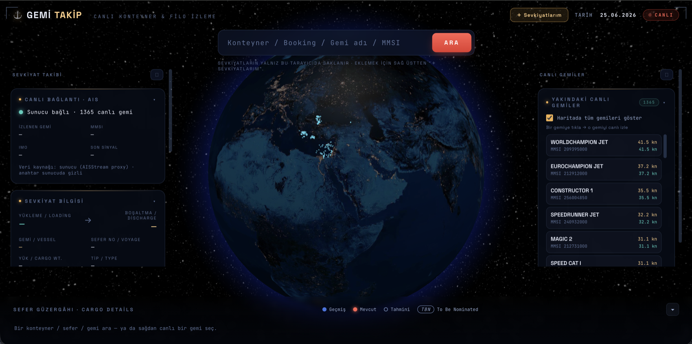

# Gemi Takip — Canlı Konteyner & Filo İzleme

3D dünya küresinde gemi/konteyner takibi. Canlı konum **AISStream** (ücretsiz AIS) →
küçük bir **Node WebSocket proxy** (server.js) AISStream'e TEK bağlantı tutar ve veriyi
tüm tarayıcılara yayınlar. Sevkiyat kayıtları her kullanıcıda **localStorage**'da; linkle paylaşılır.



```
AISStream ──(1 bağlantı, anahtar sunucuda)──► Node WS sunucu ──(4 sn snapshot)──► N tarayıcı
```

## Yerel çalıştırma
```bash
npm install
AISSTREAM_KEY=senin_anahtarin npm start      # → http://localhost:8090
```
Tarayıcıda **http://localhost:8090** aç (file:// ile değil).

## Güvenlik (deploy öncesi şart)
- **AIS anahtarı yalnız `AISSTREAM_KEY` env ile verilir** — repoda/kodda anahtar YOK; `.env` gitignore'da.
- (Geçmişte paylaşılan anahtar varsa **aisstream.io'da yenile**.)
- Sunucu yalnız `index.html`, `app.js`, `styles.css` ve `/health` servis eder (kaynak/sır sızmaz).
- WS kanalı tek yönlü (istemci sadece dinler), güvenlik başlıkları açık (nosniff, frame-deny).
- Tüm dış veri (AIS gemi adı/hedef, paylaşılan link) HTML-escape edilir (XSS koruması).

## Deploy

> **Netlify/Vercel TEK BAŞINA OLMAZ** — statik + kısa-ömürlü serverless'tir, kalıcı
> WebSocket sunucusunu çalıştıramaz. Uzun-ömürlü Node süreci gerekir.

### A) Kendi sunucunda Docker (önerilen — veritabanı yok, tek servis)
```bash
# 1) Kodu sunucuya koy (node_modules ve .env HARİÇ)
# 2) Anahtarı .env'e yaz:
echo "AISSTREAM_KEY=YENI_ANAHTARIN" > .env
# 3) Çalıştır
docker compose up -d --build
# 4) Test
curl localhost:8090/health        # → ok <sayı>
```
Container `restart: unless-stopped` ile kalıcıdır; healthcheck `/health`'i izler.

**HTTPS + dışarı açma (telefon/herkes için şart):** doğrudan `http://sunucu-ip:8090` da çalışır
ama HTTPS için bir alan adı + reverse proxy kullan. En kolayı **Caddy** (otomatik HTTPS):
```
gemitakip.alanadin.com {
    reverse_proxy 127.0.0.1:8090
}
```
Caddy WebSocket yükseltmesini otomatik yapar. HTTPS olunca frontend kendiliğinden `wss://` kullanır;
paylaşım linkleri (🔗) telefon/herkeste çalışır. (nginx de olur: `proxy_pass` + `Upgrade` başlıkları.)
Reverse proxy arkasındaysan compose'da portu `127.0.0.1:8090:8090` yapıp dış firewall'ı kapat.

### B) PaaS (CLI/git ile)
| Host | Nasıl | Not |
|---|---|---|
| **Railway** | `railway up` (yerelden) | WS ✓, env panelden |
| **Fly.io** | `fly launch && fly deploy` | WS ✓; Dockerfile'ı kullanır |
| **Render** | GitHub repo bağla | WS ✓; ücretsiz katman uykuya dalar |

### Telefon / başka kişiler
Deploy + HTTPS sonrası: bir sevkiyatın **🔗 Paylaş** → link → telefonda/herkeste rota açılır.

## Dosyalar
| Dosya | İş |
|---|---|
| `server.js` | WS proxy + güvenli statik sunucu |
| `index.html` / `styles.css` | Arayüz |
| `app.js` | Küre, telemetri, sevkiyat (localStorage), paylaşım linki |
| `.env.example` | Ortam değişkeni şablonu |

## Sınırlar
- AISStream ücretsiz = **karasal AIS** → açık okyanustaki gemi canlı görünmez (kıyı/boğaz/limanda görünür).
- Kargo olay timeline'ı (gate/yükleme/boşaltma) AIS'te yok → kullanıcı manuel girer (ücretli API ile otomatikleştirilebilir).
- localStorage cihaza özeldir; çok-cihaz/hesap için üyelik + veritabanı gerekir.
